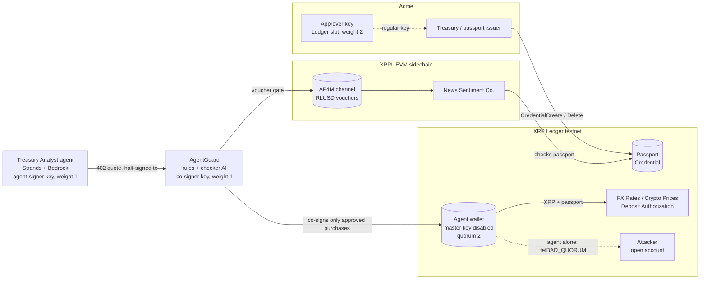

# AgentGuard: Know Your Agent, built into the XRP Ledger

**AI & Fintech XRPL Hackathon, New York, Oct 24–25 2026 · Agentic Finance track · Team: Ashwin Silla, Bhakti Talele**

AI agents now pay for the data and services they use. But merchants can't tell *which* agent is paying, and companies
can't stop a rogue agent everywhere at once. **AgentGuard** gives every AI agent a **passport on the XRP Ledger**.
Merchants accept only verified agents, and the agent **can't spend a cent without AgentGuard's co-signature**, which
AgentGuard gives only after checking the purchase against the agent's task. A **kill switch** freezes a rogue agent's
spending everywhere, attacker included, and revokes its passport across every merchant in seconds.

> **Think of an employee ID badge.** Shops in the building only serve people wearing a valid badge, and a manager must
> countersign every purchase. If the employee goes rogue, security deactivates the badge and no shop will serve them.
> On the XRP Ledger the shops don't even have to check the badge: **the network refuses the payment itself.**

## The demo story

Acme Corp's **AI Treasury Analyst** writes a daily FX and crypto risk report. It buys data per call:

| Merchant | Sells | Price | Rail |
|---|---|---|---|
| FX Rates Co. | live EUR/USD, USD/JPY (Frankfurter / ECB) | 0.05 XRP | XRP Ledger, verified-only |
| Crypto Prices Co. | live XRP, BTC (CoinGecko) | 0.05 XRP | XRP Ledger, verified-only |
| News Sentiment Co. | BBC business headlines + AI risk score | 0.25 RLUSD | Mastercard AP4M |
| "Premium Alpha Signals" (attacker) | "insider trading signals" | 5 XRP (100×) | XRP Ledger, open |

1. Acme issues the passport with its **approver key** (a Ledger device in production; a software key in the demo).
2. The agent buys FX, crypto and news. **AgentGuard checks and co-signs each payment**, with no human involved.
   If the news looks volatile it decides to buy a deeper news pull; that bigger purchase is **held for a human**, who approves it on the dashboard.
3. The agent writes the risk report.
4. The attacker's "sponsored notice" tries to lure the agent. AgentGuard **refuses to co-sign** (not on the approved list, 100× price).
5. The manipulated agent tries to **pay the attacker directly**. The **XRP Ledger rejects it** (`tefBAD_QUORUM`: no AgentGuard signature),
   so AgentGuard **freezes** the agent and closes its Mastercard channel.
6. Acme confirms with its approver key: the **passport is revoked**, a payment to FX Rates with the old passport fails (`tecBAD_CREDENTIALS`),
   and the **remaining float returns to the treasury**.
7. Acme **re-issues** the passport with one approval.

## How it works



| Layer | What it does | Enforced by |
|---|---|---|
| 1. Passport | XRPL Credential `AGENTGUARD_PASSPORT_SMALL` with an expiry, issued by Acme's approver key and accepted by the agent. The level is a label. | XRP Ledger Credentials |
| 2. Verified merchants only | FX/Crypto turn on Deposit Authorization and preauthorize Acme's passport type. No passport → `tecNO_PERMISSION`; revoked → `tecBAD_CREDENTIALS`. | XRP Ledger validators |
| 3. Co-signing checker | The agent wallet's master key is disabled. Signers: agent 1, AgentGuard 1, approver 2, quorum 2. AgentGuard co-signs only after **hard rules** (approved merchant, ≤ 3× usual price, daily budget; purchases above the auto-approve limit are held for a human) and the **checker AI** (structured facts only: task, merchant, category, price, price history; never merchant text or the agent's reasoning). | XRP Ledger multi-signing + AgentGuard (Bedrock) |
| 4. Kill switch | Repeated refusals (or, in the demo, a reported bypass attempt): **freeze** (no more co-signatures or vouchers, AP4M channel closed). Then Acme's approver confirms: **CredentialDelete** + **float swept** to the treasury. | XRP Ledger validators + Mastercard AP4M |

**The scam merchant truth:** the attacker never turns on Deposit Authorization, so revoking the passport alone would not stop
payments to it. What stops them is the **co-signature**: the agent's wallet can't pay anyone without AgentGuard. On the
Mastercard rail the equivalent is AgentGuard's **voucher gate** plus closing the funded channel.

## How each partner is used

| Partner | Role |
|---|---|
| **XRP Ledger** | Credentials (passport), Deposit Authorization + DepositPreauth (verified-only merchants), multi-signing (co-signed wallet), public audit trail. `agentguard/passport.py`, `multisig.py`, `cosigner.py` |
| **Mastercard AP4M** | News Sentiment is paid with EIP-712 vouchers in RLUSD on the XRPL EVM testnet (chain 1449000). AgentGuard's voucher gate signs only approved purchases; the kill switch closes the channel. `agentguard/ap4m.py`, see `MASTERCARD.md` |
| **AWS** | The Treasury Analyst is a **Strands Agents** agent on **Amazon Bedrock** (Amazon Nova Pro, with automatic fallback between models); the checker AI and the news risk score use Bedrock too. Labelled `LLM OFFLINE` fallback if Bedrock is unreachable. `agents/treasury_analyst.py`, `agentguard/checker.py`, `agentguard/llm.py` |
| **Ledger** | The approver key fills the Ledger device's slot (weight 2) in the agent's signer list and is the issuer's regular key, so swapping in a device or the Speculos emulator changes only which key signs. |
| **Quicknode** | **All XRP Ledger traffic runs through our Quicknode testnet endpoint** (JSON-RPC: payments, multi-signed submissions, passports, checks). The dashboard's live ledger feed (`agentguard/ledger_feed.py`) subscribes over the **Quicknode WebSocket** to the agent, Acme and the vendors, and shows every validated transaction as the ledger saw it: an independent witness to what our code claims. (A `POST /webhooks/quicknode` route for Quicknode Streams exists but isn't connected in this demo.) |

## Run it

```bash
uv venv --python 3.12 .venv && uv pip install --python .venv/bin/python -r requirements.txt
cp .env.example .env                       # then add XRPL_AGENT_ADDRESS + XRPL_AGENT_SECRET yourself
.venv/bin/python scripts/setup_wallets.py   # Acme (issuer/treasury) + Layer 1 merchant, from the faucet
.venv/bin/python scripts/setup_vendors.py   # the four vendor wallets; FX/Crypto/News become verified-only
.venv/bin/python scripts/setup_agent_wallet.py  # signer keys, approver = Acme regular key, signer list, master key off
.venv/bin/python scripts/reset_demo.py      # passport active, float 10 XRP, strikes cleared
.venv/bin/python run_demo.py                # preflight + merchants :8000 + dashboard http://127.0.0.1:8080
```

Other commands: `scripts/preflight.py` (green/red checklist), `scripts/e2e_testnet.py` (full scenario on testnet → `PROOF.md`),
`.venv/bin/python -m pytest -q` (17 offline tests). The 3-minute walkthrough is in `DEMO_SCRIPT.md`.

## Proof (real testnet transactions)

All hashes are in [`PROOF.md`](PROOF.md). Highlights from the end-to-end run:

| Step | Ledger said |
|---|---|
| News paid through Mastercard AP4M: voucher redeemed on the PaymentLedger | [VoucherRedeemed](https://explorer.testnet.xrplevm.org/tx/0x273ac3cf9ebfca849b501ffa14d8425858eaf3d652bda12065d34e6ae0602c7f) |
| RLUSD settled to the merchant payout wallet | [ClaimPaid + SettlementRecorded](https://explorer.testnet.xrplevm.org/tx/0x8a2d4593693fa67460a3d739452dac371624ef38b9ecd96609e03d727f38c2ad) · [verifiable receipt](https://hackathon.ap4m.build/public/evidence/claims/0x54aa6cf1778faf89a36160280a338f3ceea39f40111c80a147cf35fb1f07c7e8/0xd03af392f09eebd2d10684e2f9d614d0476f64c4640bf03cbfa29b1300a10e89.json) |
| Voucher above the 5 RLUSD channel cap | reverted by the PaymentLedger |
| FX Rates paid, co-signed by agent + AgentGuard | [tesSUCCESS](https://testnet.xrpl.org/transactions/E8F859DC9DD4A1B94BDE5BA98E99016AA3EFFA7955F10E687E8B3AA1ACDD752E) |
| Agent pays the attacker alone | `tefBAD_QUORUM` (refused before reaching a ledger) |
| Passport revoked with Acme's approver key | [tesSUCCESS](https://testnet.xrpl.org/transactions/402E78C68ABDA4B254EDF976E5E04895AE906C0CA868830370A5B0C67D3B5B97) |
| FX Rates payment with the old passport | [tecBAD_CREDENTIALS](https://testnet.xrpl.org/transactions/5419F18D92959009BD8310C32A8114BB8ABD4E367932086722F41EF0CCD8D9E8) |
| Float returned to the treasury | [tesSUCCESS](https://testnet.xrpl.org/transactions/43690768CE7F818E0B60EA4306CD2D6F0CE89360BCB2C45EFD841262793FBE82) |
| FX Rates payment with no passport | [tecNO_PERMISSION](https://testnet.xrpl.org/transactions/749B6979ADA58450DE8DDAD81F59B38D51668B981C3A8E77880232C5DFACE787) |

## Repository map

| Path | What |
|---|---|
| `agentguard/passport.py` | issue / accept / revoke / status of the passport |
| `agentguard/multisig.py` | signer roles, multi-signed submit, spendable float |
| `agentguard/cosigner.py` | AgentGuard's co-signature: only for exactly what the checker approved |
| `agentguard/checker.py` | hard rules + checker AI (structured facts only), strikes |
| `agentguard/killswitch.py` | freeze → confirm (revoke, refusal proofs, float sweep) |
| `agentguard/ap4m.py` | Mastercard AP4M: sign-in, channel, voucher gate, redeem, close (LIVE or labelled MOCK) |
| `agentguard/buyer.py` | the only purchase path (402 → checker → co-sign / voucher → data); `pay_direct` bypass attempt |
| `merchants/` | the four x402 merchants (two rails) and their real data sources |
| `agents/treasury_analyst.py` | the Strands agent (and the labelled OFFLINE planner) |
| `dashboard/` | live dashboard (SSE feed, buttons) |
| `scripts/` | setup, preflight, reset, end-to-end proof |
| `vendors.py`, `agent_client.py`, `scripts/demo_layer1.py`, `demo_layer2a.py` | **superseded** Layer 1/2a proofs from before multi-signing (they sign as the agent alone, which the ledger now refuses) |

## Honest limitations

- **Two networks.** Ledger-level blocking and co-signing apply on the main XRP Ledger. On Mastercard's rail, enforcement is the merchant checking the passport, AgentGuard's voucher gate, and closing the channel.
- **Mastercard channel close is simulated during rehearsals** (`KILL_SWITCH_CLOSE_REAL_CHANNEL=false`); set it to `true` for the final demo to really close the channel.
- **The attack is simulated.** A well-aligned LLM usually ignores the injected offer, so the demo runs a clearly labelled *SIMULATED HIJACK* using the same tools.
- **Merchants must opt in.** It's one setting; a merchant can open a separate "verified agents" address so its other customers are unaffected.
- **The checker AI can be wrong.** Uncertain purchases are held for a human; there is no accuracy metric yet (it needs a labelled test set).
- **The bypass attempt is self-reported in the demo.** A payment the ledger refuses with `tef…` never reaches a ledger, so AgentGuard can't observe it in general (and it has no explorer page). In the demo the agent's runtime reports the attempt, which fires the freeze. In production the freeze comes from repeated refusals (strikes). Either way the money is safe, because the ledger refuses the payment.
- **All keys sit on one machine in the demo.** The agent-signer, AgentGuard and approver keys are all in one `.env` and one process. The design separates them (agent runtime / a separate AgentGuard service with an HSM / a Ledger device for Acme); this deployment doesn't, so "an attacker must break two systems" describes the architecture, not this demo.
- **AgentGuard is a required signer.** If it's down the agent can't pay (the safe default). A hacked AgentGuard alone still can't pay: it needs the agent's signature too, and the float is small.
- **No Ledger device on site.** A software approver key fills the device's slot.
- **Passport levels are labels**, not ledger-enforced limits. **Prototype on testnets**; production needs secure key storage.
